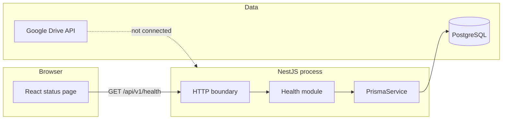

# System architecture

The dashed Drive dependency is a planned adapter. Nothing in the process imports a Google client.

## Processes

| Process | Port | How it is started |
|---|---|---|
| Web dev server | 43123 | `pnpm dev:web` |
| API | 43124 | `pnpm dev:api` or `node dist/main.js` |
| PostgreSQL | 5432 | Docker Compose or an existing server |

There is no worker process.

## Trust boundaries

- The browser is untrusted. It cannot choose a database URL or a Drive folder.
- The API is the only component that should hold `DATABASE_URL`.
- PostgreSQL is reachable from the API host. The local Compose file publishes port 5432 for development. A deployed database should not be published that way.
- Drive, when added, is called only from the storage adapter with folder ids stored in PostgreSQL, not with parent ids posted by the browser.
