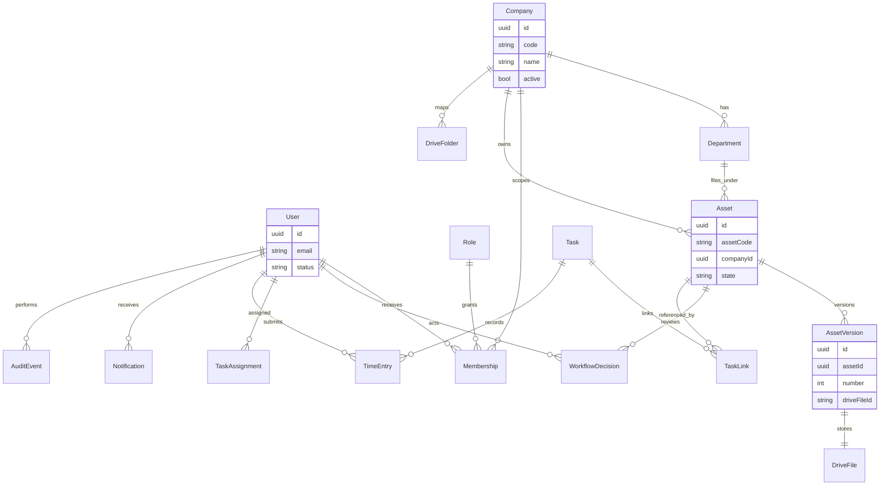

# Database model

## Implemented

PostgreSQL 16. Prisma migration history includes `User`, `Session`, `Company`, `Membership`, `Department`, `FolderCatalog`, `Asset`, `UploadOperation`, `AssetVersion`, `WorkflowDecision`, `Task`, `TaskAssignment`, `TaskLink`, `TimeEntry`, `Notification`, and `AuditEvent`. `FolderCatalog.driveFolderId` is null. Asset and version state is only `upload_failed`. Asset review stage starts at `draft`. Publication is `not_started` or `not_run`. File bytes are not stored. No version has a Drive file id. A time entry stores the minutes that were entered. It does not store a payroll total. A notification stores a body and an href for one user. It does not send email. An audit row stores a sentence for one completed company change. It has no `updatedAt`. `subjectId` is stored without a foreign key, so deleting the task or asset does not remove the sentence.

```text
_prisma_migrations
  id, checksum, migration_name, started_at, finished_at, applied_steps_count
```

Databases used locally:

| Name | Use |
|---|---|
| `dam` | API `DATABASE_URL` |
| `dam_test` | End-to-end tests via `TEST_DATABASE_URL` |

Binary files are not stored here. That rule stays in force when the tables below are added.

## Planned model

Company, Membership, Department, FolderCatalog, Asset, AssetVersion, WorkflowDecision, Task, TaskAssignment, TaskLink, TimeEntry, Notification, and AuditEvent are migrated. `DriveFolder` and `DriveFile` in the diagram are not. Names can change in the module that introduces them, but the relationships should not be casually collapsed.



### Company codes

Seeded by `20261010170000_company_and_membership`: `BAPL`, `SAPL`, `GBAPL`, `KABPL`, `Ontale`. No `ASEDS` row. `name` currently matches `code`.

### Rules the migrations must keep

- Company id is part of every business row that a user can list.
- Asset id is stable across versions. Version number increases. Approved versions are not overwritten in place.
- `driveFileId` and `driveFolderId` are opaque strings returned by Drive, never a path invented by the client.
- Audit rows are inserted, not updated, by application code.
- Time entries belong to a user and a company, and optionally a task in that same company.

Indexes and unique keys are specified in the module that creates the table. Expected uniques: company code, user email, `(assetId, versionNumber)`, and one active membership per user, company, and role.
