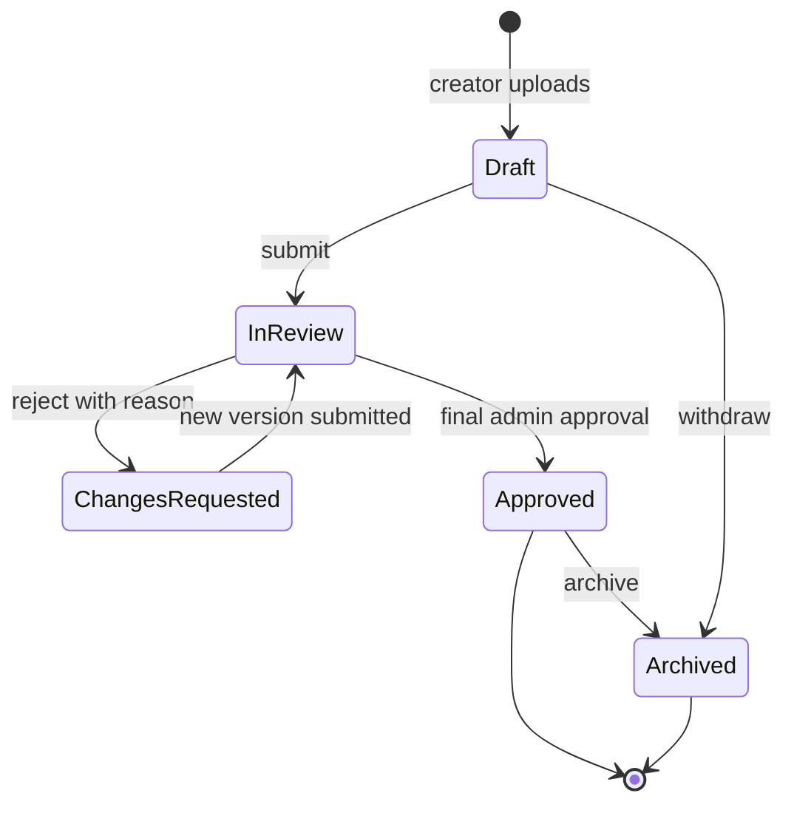

# Asset lifecycle

The upload failure path is implemented. Search matches the code, title, or file name, and a member can change the title. A new attempt keeps the same asset id and adds `v002` without removing `v001`. Review stages from draft through admin approval are recorded. Admin approval does not move a file, so the stage stays `admin_approval` and `publication` is `not_run`. Archive is not implemented. Every version stays `upload_failed` and has no preview and no Drive file.

The approval document breaks `InReview` into the named stages. This diagram is the asset's storage lifecycle, not every QC step.

## Rules

- The asset id does not change when a new file is uploaded.
- Version numbers start at 1 and increase by 1. Display them as `v001` in the UI.
- Each version has its own Drive file id.
- Rejection does not delete the rejected file.
- Approval moves the approved version's file into `02_Approved` for its type folder. Older versions stay where they were unless a later rule says to archive them.
- Archive moves the file into `03_Archive` and sets the asset state. It does not remove the database row.
- Trash or delete is an admin action with an audit row. It is not the same as archive.

## Identity

A human-readable asset code is unique inside a company. The database primary key is a UUID. Searches accept the code. URLs use the UUID so a renamed code does not break a link.

## What Module 0 does not do

There is no asset id generator, no upload route, and no sample asset.
