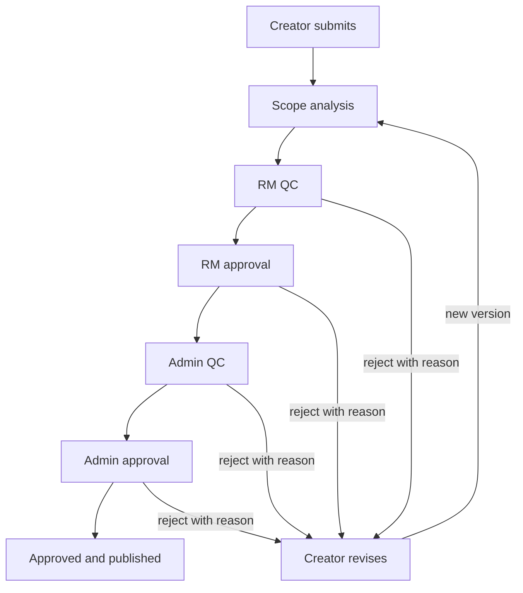

# Approval workflow

Implemented as `WorkflowDecision` rows. The client shows only the actions the API returns for the caller. Admin approval does not reach a published stage, because Google Drive is not called and no file exists to move. ADR 0015.

## Rules the engine must enforce

| Rule | Reason |
|---|---|
| Only the role named on the current stage can decide it | Stops a creator from approving their own file |
| Rejection without a reason is invalid | Reviewers need a record the creator can answer |
| A decision names the asset version it reviewed | A new upload must not inherit an approval of an older file |
| Resubmission starts at scope analysis on the new version | Silent continuation would skip review |
| The final approval moves the file to `02_Approved` | Publication is a storage action, not only a label. It is recorded as `not_run` until Drive can do it |
| If that move fails, the asset stays in the last successful state and the operation is retryable | The stage stays `admin_approval`. `publish` retries the same failure |
| Every transition writes an audit event | The decision row is that record for review. A general audit log remains Module 14 |

Stages can later be configured per company. The default sequence above is the one tests should use until configuration exists. A company cannot skip admin approval by editing the client.

## Unauthorized and invalid transitions

Return 403 when the caller is not allowed to act, and 409 when the asset is not in the expected state. Do not return 200 with an unchanged asset.
